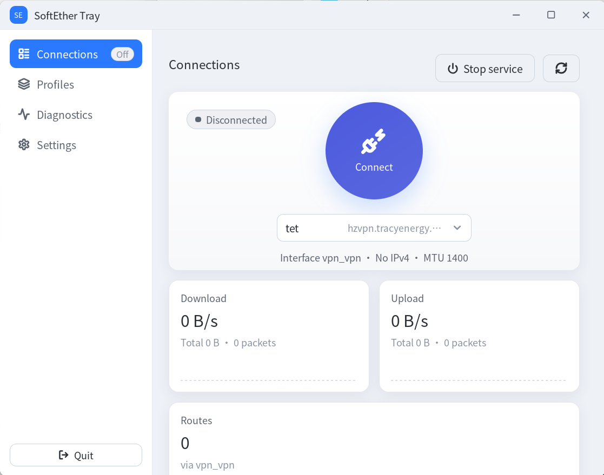

# SoftEther Tray

**English** | [简体中文](README.zh-CN.md) · [Detailed usage guide](docs/usage.md)

A SoftEther VPN client that lives in the Linux system tray. The official SoftEther distribution ships a Windows Client Manager only — on Linux you get `vpncmd` — so this app adds a GUI on top of it.



## Features

- Reads **all existing connection profiles** from the SoftEther client; no shadow copy of the configuration
- Connect / disconnect, create / edit / delete profiles, create virtual network adapters
- Tray resident: shows connection status, left-click opens the main window, the menu can connect or disconnect any profile
- Status panel: tunnel IP, server, HUB, MTU, total traffic, and live up/down rate charts
- Network diagnostics: packet loss / latency checks against any intranet target
- Desktop notifications on connection changes; optional launch at login and auto-connect
- Interface styles: Windows 11 (Fluent), Deepin 25, and macOS, previewed live in Settings
- Bilingual interface: Simplified Chinese and English, switchable in Settings; on first launch it follows the system locale (Chinese for mainland China, English elsewhere)
- Choose the SoftEther client directory: bundled, auto-detected, or a custom path
- Custom title bar (no system decoration): drag to move, double-click to maximize, edge resizing; the close button still hides to tray

## The two gaps it fills

The SoftEther Linux client does neither of these; the original `vpn-tracy` script handled them with manual routes. This app turns the same logic into configurable behavior:

1. **Subnet routes**: installed only after the connection succeeds, so intranet subnets go through the tunnel
2. **Default-route safety net**: the VPN never takes over the default route

On disconnect, subnet routes are removed and the adapter address is cleared, so no stale route sends intranet traffic into a dead tunnel.

## UDP acceleration

The official 4.44 Linux client has **no** `vpncmd` switch to disable UDP acceleration. `AccountDetailSet` only supports `/MAXTCP`, `/INTERVAL`, `/TTL`, `/HALF`, `/BRIDGE`, `/MONITOR`, `/NOTRACK`, and `/NOQOS`. To turn it off you must edit the client configuration file:

```bash
vpn-tracy stop           # stop the client first, otherwise it writes the old config back on exit
# set NoUdpAcceleration to true in vpn_client.config
vpn-tracy
```

The `tet` profile on this machine already has it disabled. If you see unusually high traffic, the client pegging a CPU core, or intranet packet loss, check this first.

## Privileges

Reading status uses the current user's `vpncmd`. Changing routes, starting the service, and creating adapters require root; the app uses `pkexec` to show a graphical password prompt instead of blocking on stdin in a terminal.

## Development

```bash
npm install
npm run tauri dev
```

Build the installer:

```bash
npm run tauri build
```

The artifacts are under `src-tauri/target/release/bundle/deb/`.

Rust tests:

```bash
cd src-tauri && cargo test --lib
```
